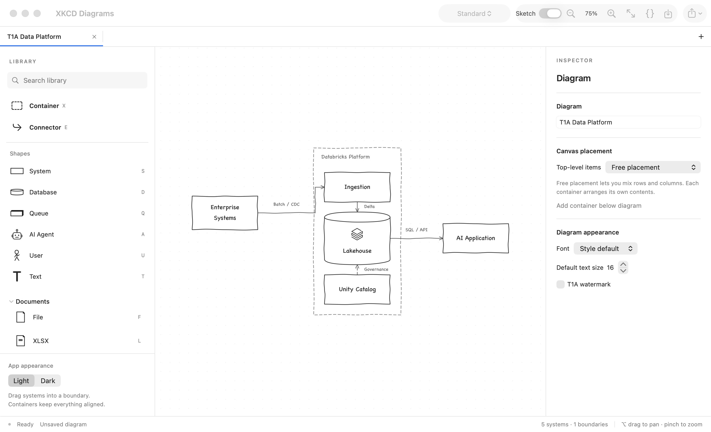
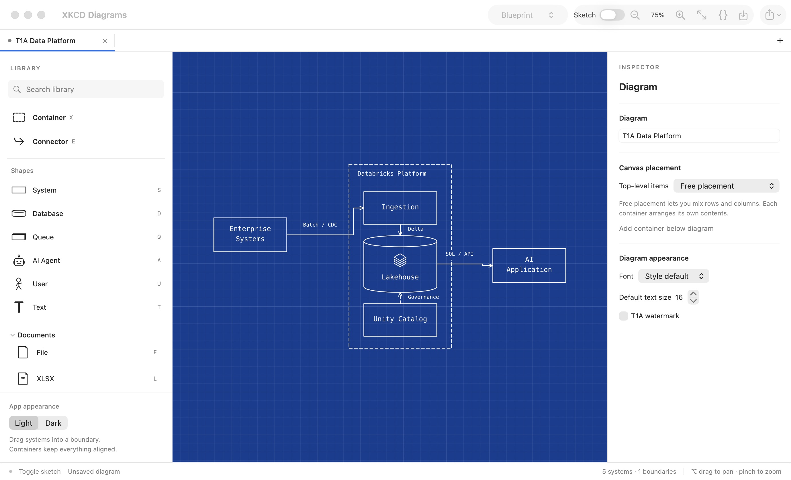
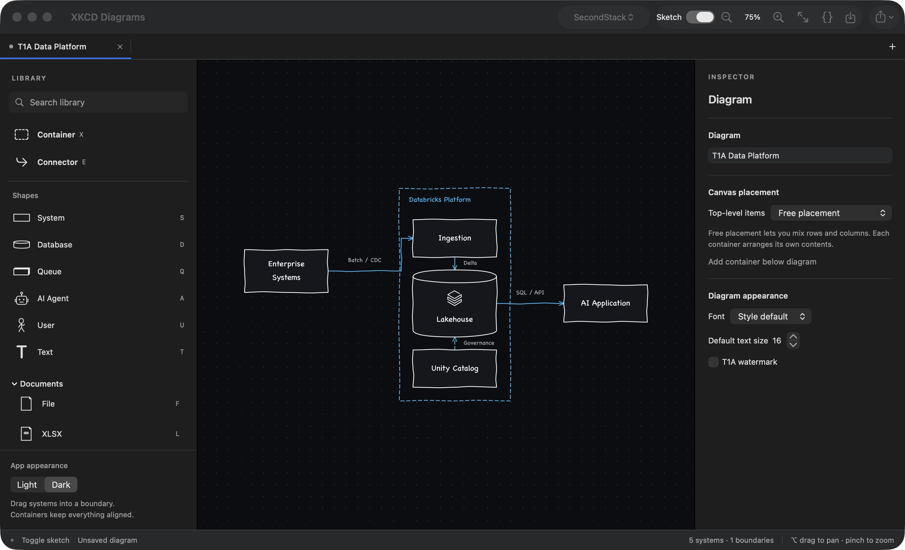

# XKCD Diagrams

A native macOS app for enterprise and IT architecture diagrams, built around T1A conventions. Draw manually with drag and drop, or let an agent create the same editable JSON document through the CLI.



## Features

- Three document modes: system diagrams, free mouse drawing with smoothed strokes and text, and Gantt-style timelines.

- Containers with horizontal, vertical, free, and custom grid layouts, including spanning rows and columns.
- A borderless canvas, orthogonal connectors, zoom and pan, and tabs with separate editing histories.
- Five diagram color themes: Standard, Blueprint, Dark, SecondStack, and 8FDE. Each supports an independent Sketch toggle.
- A grouped logo library for T1A, Databricks, Azure, AWS, OpenAI, and Anthropic, including black and white marks.
- System, database, queue, AI Agent, User, and text shapes, plus File, XLSX, PDF, and DOCX document presets.
- Per-item line widths and text sizes, keyboard shortcuts, copy/paste, and quick label editing.
- Editable `.diagram.json` documents and PNG/SVG exports, with an optional T1A watermark.
- A CLI and bundled agent skill sharing the editor's document model, layout engine, and renderer.

## Installation

### Requirements

- macOS 14 or later.
- Swift 6.0 or later, provided by Xcode 16 or later or compatible Apple Command Line Tools.
- Git to clone the repository. There are no third-party package dependencies.

Install Apple's developer tools if needed, then check your Swift version:

```sh
xcode-select --install
swift --version
```

Skip `xcode-select --install` if the tools are already installed. If your selected tools provide Swift 5, install a newer compatible toolchain before building.

### Build and install the macOS app

```sh
git clone https://github.com/nbnm/xkcd-diagrams.git
cd xkcd-diagrams
./scripts/build-app.sh release

mkdir -p "$HOME/Applications"
ditto "dist/XKCD Diagrams.app" "$HOME/Applications/XKCD Diagrams.app"
open "$HOME/Applications/XKCD Diagrams.app"
```

The build produces `dist/XKCD Diagrams.app`, `dist/diagram`, and its resource bundle. It targets the local machine's architecture. The app is locally signed for development; it is not a notarized distribution build.

The installed app includes its logo library and schema and runs independently of the checkout and build cache. You can also copy it to `/Applications` to install it for all users.

For development, run the app directly from `dist/` after building. `./scripts/build-app.sh debug` creates a debug build.

To update, quit every running copy before rebuilding or replacing an app bundle. From your checkout, run `git pull --ff-only`, rebuild, then repeat the `ditto` and `open` commands above.

### Use the CLI

Run the CLI directly from the checkout:

```sh
dist/diagram help
```

To make it available in your current shell:

```sh
export PATH="$PWD/dist:$PATH"
diagram help
```

Keep `diagram` and `XKCDDiagrams_DiagramCore.bundle` together if you move the CLI. The bundle contains the schema and symbol library. The macOS app does not need to be running for CLI commands.

### Codex skill

The complete skill is in [skills/xkcd-diagrams](skills/xkcd-diagrams/SKILL.md). Codex's [official skills documentation](https://learn.chatgpt.com/docs/build-skills) lists `~/.agents/skills` for user skills. Build the CLI first, then run these commands from the repository root:

```sh
diagram_skill_root="$HOME/.agents/skills"
mkdir -p "$diagram_skill_root"
ditto "skills/xkcd-diagrams" "$diagram_skill_root/xkcd-diagrams"
XKCD_DIAGRAM_CLI="$PWD/dist/diagram" \
  "$diagram_skill_root/xkcd-diagrams/scripts/diagram.sh" help
```

The helper must know the absolute path to your built CLI. For the Codex CLI, set it in the launch environment:

```sh
XKCD_DIAGRAM_CLI="$PWD/dist/diagram" codex
```

For the Codex desktop app, configure the fallback path in the installed `scripts/diagram.sh` to your checkout's absolute `dist/diagram` path. Preserve the `${XKCD_DIAGRAM_CLI:-...}` syntax and replace only the path after `:-`. The bundled fallback matches the original development checkout; other machines need this configuration. Repeat the copy command to update the installed skill, then reapply your local fallback path.

Start a new message after installation; if the skill is not listed, restart Codex. Invoke it explicitly as `$xkcd-diagrams`, or use it for a diagram request. Other agents can use the skill in their supported skills directory with the CLI path configured for their machine.

## Getting started

The first launch opens a T1A data platform example. Use **⌘N** or **⌘T** for a blank diagram. Choose an item in the toolbox, drag it onto the canvas, or press its shortcut and click to place it.

| Action | Shortcut |
| --- | --- |
| Place Container | X |
| Select Connector | E or ⌘K |
| System / Database / Queue | S / D / Q |
| AI Agent / User / Text | A / U / T |
| File / XLSX / PDF / DOCX | F / L / P / W |
| New tab / Close tab | ⌘T / ⌘W |
| Open / Save | ⌘O / ⌘S |
| Copy / Paste | ⌘C / ⌘V |
| Undo / Redo | ⌘Z / ⇧⌘Z |
| Zoom in / Zoom out / Fit | ⌘= / ⌘− / ⌘0 |
| Cancel a tool or leave a text field | Escape |

Single-key tools work outside text fields. Every toolbox item has a hover tooltip; platform groups use a number followed by the item's key. Double-click an item to edit its name. Select a container to arrange its contents, or select the canvas to set top-level placement. Select an item before changing its line width or text size.

Container and Connector live in the toolbox. The top toolbar controls diagram colors, sketch strokes, zoom, source editing, saving, and exporting. The full saved file path appears in the bottom status bar; click it to reveal the file in Finder. Saved files autosave later edits, and saved tabs reopen on the next launch.

See the [editor guide](docs/EDITOR.md) for layouts, grid spans, connectors, all platform shortcuts, tabs, themes, and file behavior.

## Free Drawing and Timeline modes

Use the **Mode** control at the top left to switch between Diagram, Free Drawing, and Timeline. Switching selects an existing tab of that type or opens a new one, preserving current work. File → New Free Drawing / New Timeline creates another document; **⌘T** creates a new tab in the current mode.

**Free Drawing** has Pen (**P**), Select (**V**), Text (**T**), and Eraser (**E**). Draw with the mouse; smoothing removes jitter while retaining the original points. Pen width and smoothness defaults live in the sidebar. Select a stroke to adjust only that stroke or drag it to move it. Eraser removes whole strokes or text items, with one undo step per gesture. Choose Text and click anywhere to type; **⌘Return** commits and **Escape** cancels. Double-click existing text to edit it. Copy/paste and undo/redo work for strokes and text.

**Timeline** has tasks (**N**) and milestones (**M**), day/week/month scales, owners, completion percentages, and predecessor links. Drag the middle of a bar to move its dates, drag either end to resize it, or drag its task-name row vertically to reorder. Edit exact dates and duration in the inspector. Dates use calendar days, including weekends; finish dates are inclusive. Predecessors are visual finish-to-start links. Scheduling is manual, and the inspector flags a task that starts before a predecessor finishes. Dependency cycles are rejected. This mode does not import Microsoft Project files or provide critical-path/resource planning.

All modes share tabs, themes, zoom/pan, editable JSON, save/autosave, and PNG/SVG export. Old files open as diagrams. Agents can initialize either new mode:

```sh
mkdir -p diagrams
dist/diagram init diagrams/sketch.diagram.json --mode drawing --example
dist/diagram init diagrams/project.diagram.json --mode timeline --example
```

## Diagram styles

Blueprint uses blue drafting paper, a thin grid, and white ink. This screenshot has Sketch turned off:



The app's Light/Dark interface setting is separate from the diagram color theme. Here, the dark interface surrounds a SecondStack diagram with Sketch enabled:



All five color themes work with clean or sketch strokes. Logos remain undistorted. Theme and stroke settings are saved in the diagram and used by PNG/SVG exports.

## Agent and CLI workflow

Create, validate, and render an example without opening the editor:

```sh
mkdir -p diagrams
dist/diagram init diagrams/example.diagram.json --example
dist/diagram validate diagrams/example.diagram.json --json
dist/diagram render diagrams/example.diagram.json --format png --output diagrams/example.png --scale 2
dist/diagram render diagrams/example.diagram.json --format svg --output diagrams/example.svg
```

Inspect the supported schema and bundled presets before authoring JSON:

```sh
dist/diagram schema
dist/diagram library list
```

For an existing file, capture `dist/diagram revision <original>`, write and validate a candidate, then apply it with `dist/diagram write <original> --from <candidate> --expect <revision>`. A stale revision fails without overwriting the source. Cooperating writers use a sidecar `.lock` file; agents should use the guarded write command.

The [skill's format guide](skills/xkcd-diagrams/references/format.md) documents the shared JSON representation. Examples are available in [Examples](Examples/).

## Verification and development

```sh
./scripts/check.sh
./scripts/check-app.sh
```

The core suite contains 77 checks covering document validation, layout, routing, themes, exports, clipboard behavior, and symbols. Fourteen app checks exercise the editor/workspace stores, tab independence, file deduplication, close protection, restoration, external edits, autosave cancellation, native drawing/text/eraser gestures, Gantt drag/resize/reorder, mode switching, and clipboard behavior. The checks use standalone Swift executables and work with Command Line Tools installations.

| Source | Purpose |
| --- | --- |
| `Sources/DiagramCore` | Document model, layout, routing, symbols, exports, and guarded file writes |
| `Sources/DiagramApp` | SwiftUI workspace, AppKit canvas, and editor state |
| `Sources/DiagramCLI` | Headless commands for agents and scripts |
| `Tests/DiagramChecks` | Core regression checks |
| `Tests/DiagramAppChecks` | Editor and workspace checks |
| `skills/xkcd-diagrams` | Portable agent instructions and CLI helper |

See the [PRD](PRD.md) for product scope and [asset notes](docs/ASSETS.md) for logo sources and geometry. Vendor names and logos belong to their respective owners.

## Current limits

This is a working prototype. Orthogonal routing can still require manual waypoints to clear obstacles. Multiple selection, reusable profile editing, crash recovery, a native asset import UI, and font-weight controls remain to be implemented. Nested container layouts are supported; full graph layout is outside the initial scope.
